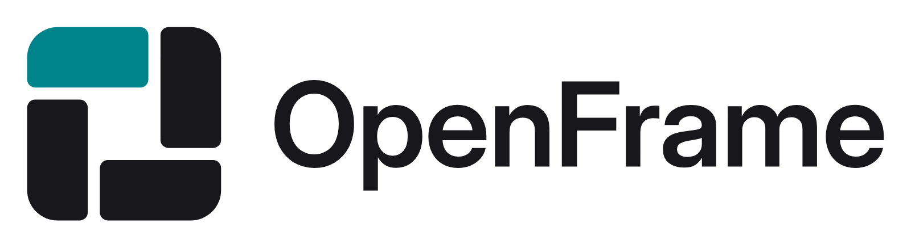
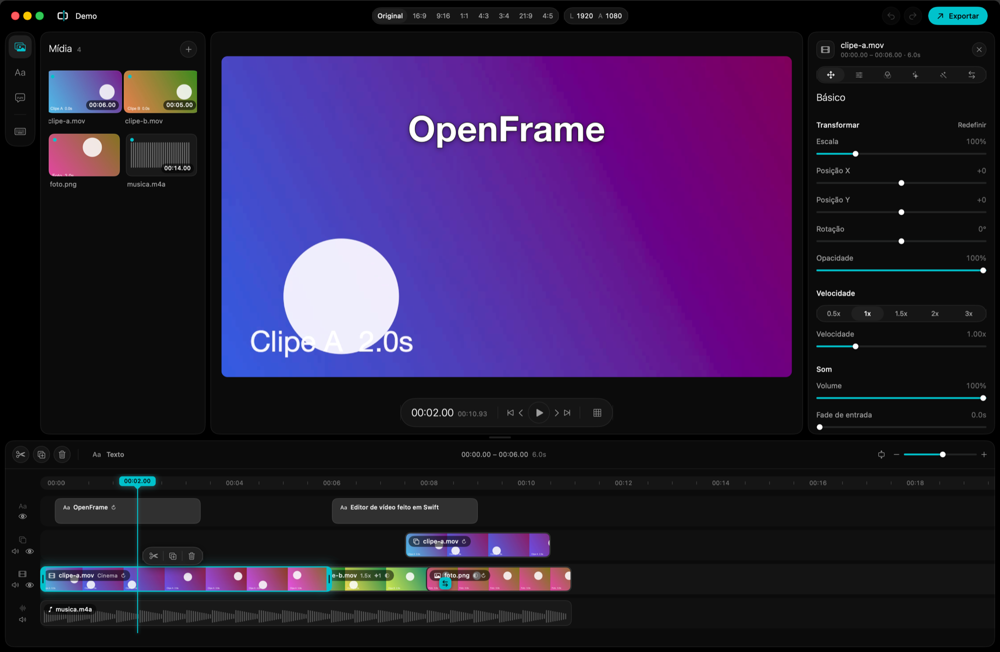

<p align="center">
  <picture>
    <source media="(prefers-color-scheme: dark)" srcset="assets/brand/png/openframe-lockup-horizontal-color-on-dark-1600.png">
    
  </picture>
</p>

<p align="center">
  <strong>Editor de vídeo leve e offline, com controle total da exportação. Para Mac, Windows e Linux.</strong>
</p>

<p align="center">
  <a href="https://github.com/talescavalcanti/OpenFrame/releases/latest"></a>
  <a href="https://github.com/talescavalcanti/OpenFrame/releases/latest"></a>
  <a href="https://github.com/talescavalcanti/OpenFrame/releases/latest"></a>
</p>

<p align="center">
  <a href="https://github.com/talescavalcanti/OpenFrame/releases/latest"></a>
  
  
  
  
  
</p>

<p align="center">
  
</p>

---

## A proposta

Editar um vídeo curto não devia exigir um app de vários gigabytes, uma conta ou
uma conexão com a internet. O **OpenFrame** é um editor de vídeo feito do zero
para o Mac, em Swift, com a experiência dos editores populares de timeline
(faixas, clipes, texto, transições, efeitos) e nada além do necessário. A versão
para **Windows e Linux** (C++, Qt e FFmpeg) tem a mesma interface e abre os
mesmos projetos `.openframe`.

- **Nativo e leve.** No Mac, usa AVFoundation e Core Image, os mesmos motores do macOS.
  O instalador tem cerca de 3 MB; o app de referência que inspirou o projeto passa de 2,6 GB.
- **Seu material fica com você.** Não há conta, nuvem nem telemetria: o app não
  faz nenhuma chamada de rede. Tudo roda localmente, inclusive sem internet.
- **Sem marca d'água e sem assinatura.** O que você exporta é só seu.
- **Exportação sob controle.** Resolução, fps, codificador, bitrate ou tamanho
  de arquivo alvo, com estimativa ao vivo antes de exportar.
- **O que se vê é o que se exporta.** O preview e a exportação usam o mesmo
  compositor, e as cores originais de vídeos e fotos são preservadas.

O conjunto de funcionalidades foi levantado estudando o CapCut para Mac por
engenharia reversa (análise estática, com o [REA](docs/REFERENCIA-REA.md)). O
código do OpenFrame é original: nada do binário, das bibliotecas ou dos recursos
da ByteDance foi reaproveitado.

## Baixar e instalar

Os arquivos de cada sistema ficam na [página da última versão](https://github.com/talescavalcanti/OpenFrame/releases/latest).

### macOS

1. Baixe o **`OpenFrame-<versão>.dmg`** na [página da última versão](https://github.com/talescavalcanti/OpenFrame/releases/latest).
2. Abra o `.dmg` e arraste o **OpenFrame** para a pasta **Aplicativos**.
3. Abra o OpenFrame pela pasta Aplicativos ou pelo Launchpad.

**Na primeira abertura**, o macOS avisa que não pode verificar o app, porque ele
ainda não é notarizado pela Apple. Para liberar:

- vá em **Ajustes do Sistema → Privacidade e Segurança**, role até o aviso sobre o
  OpenFrame e clique em **Abrir Mesmo Assim**; ou
- no Terminal: `xattr -dr com.apple.quarantine /Applications/OpenFrame.app`

Depois disso, ele abre normalmente. Requer **macOS 14 (Sonoma) ou superior**, em
Mac com Apple Silicon ou Intel.

### Windows

- **Instalador:** baixe o `OpenFrame-<versão>-windows-x64-instalador.exe` e
  execute. Sem permissão de administrador, ele instala só para o seu usuário. Os
  projetos `.openframe` passam a abrir com duplo clique.
- **Portátil:** baixe o `OpenFrame-<versão>-windows-x64-portatil.zip`, extraia
  e abra o `OpenFrame.exe` de dentro da pasta.

**Na primeira abertura**, o Windows SmartScreen pode avisar que o app não é
reconhecido, porque ele ainda não é assinado. Clique em **Mais informações →
Executar assim mesmo**. Requer Windows 10 ou 11 de 64 bits.

### Linux

Baixe o `OpenFrame-<versão>-x86_64.AppImage`, dê permissão de execução e abra:

```bash
chmod +x OpenFrame-*-x86_64.AppImage
./OpenFrame-*-x86_64.AppImage
```

Funciona nas distribuições x86-64 recentes (Ubuntu 24.04 ou superior, Fedora 40
ou superior e equivalentes), em X11 ou Wayland (pelo XWayland). Se o AppImage
reclamar de FUSE, instale o `libfuse2` (no Ubuntu 24.04: `sudo apt install libfuse2t64`).

Nos três sistemas, os projetos ficam na pasta de vídeos do usuário
(`Filmes` no Mac, `Vídeos` no Windows e no Linux), em `OpenFrame/Projetos`.

## Funcionalidades

**Projetos**
- Tela inicial com todos os projetos: miniatura, duração, formato e data da última edição; busca por nome
- Novo projeto vazio ou num formato pronto: 16:9 (YouTube), 9:16 (Reels, TikTok, Shorts), 1:1 e 4:5
- Salvamento automático em `~/Movies/OpenFrame/Projetos`, sem janela de salvar
- Renomear, duplicar, mostrar no Finder e apagar (vai para o Lixo); abrir ou exportar arquivos `.openframe`

**Edição**
- Importar vídeos, fotos e áudios pelo botão ou arrastando arquivos para a janela
- Timeline com faixa principal magnética, sobreposições (picture-in-picture), textos e áudios
- Mover, reordenar, aparar pelas bordas, dividir (⌘B), duplicar (⌘D) e apagar (⌫), com ímã
- Arrastar mídia da biblioteca direto para a timeline, e clipes entre faixas
- Zoom da timeline com pinça, ⌘ + roda e "Ajustar à janela" (⇧Z); rolagem que acompanha a reprodução
- Velocidade de 0,1× a 10×, com o tom do áudio preservado
- Desfazer e refazer ilimitados (⌘Z / ⇧⌘Z)
- Canvas 16:9, 9:16, 1:1, 4:3, 3:4, 21:9, 4:5 ou original, com fundo preto, colorido ou desfocado

**Visual**
- Transformar: escala, posição, rotação e opacidade
- Ajustes: brilho, contraste, saturação, exposição, temperatura, tint, realces, sombras, matiz, nitidez, vinheta, desbotar e granulado
- 14 filtros com intensidade e miniaturas
- 10 efeitos: desfoque, pixelizar, glitch RGB, espelho, tremor, flash, pulso de zoom, caleidoscópio, quadrinhos e contornos neon
- Animações de entrada e saída: esmaecer, zooms, deslizar (4 direções), girar e máquina de escrever
- 9 transições: dissolver, escurecer, clarear, cortinas, empurrar e zoom com desfoque

**Texto e legendas**
- Família e estilo de fonte, tamanho, negrito, itálico, sublinhado e maiúsculas
- Espaçamento entre letras e entre linhas
- Contorno por fora da letra, sombra (cor, distância, ângulo e desfoque) e fundo com cantos arredondados
- Estilos prontos: clássico, contorno, destaque, neon, legenda, etiqueta, sombra dura e espaçado
- Importar e exportar legendas SRT

**Áudio**
- Faixas de música, volume, fade de entrada e de saída, silenciar faixa
- Forma de onda nos clipes e nas miniaturas da biblioteca
- Crossfade automático nas transições da faixa principal

**Exportação**
- Resolução: 480p, 720p, 1080p, 2K, 4K, 8K ou personalizada
- Taxa de quadros: 23,976 / 24 / 25 / 29,97 / 30 / 50 / 59,94 / 60 / 120 fps
- Codificador: H.264, HEVC ou Apple ProRes 422; formato MP4, MOV ou M4A (só áudio)
- Qualidade: mais baixa, recomendada, mais alta, bitrate personalizado (Mbps) ou tamanho de arquivo alvo (MB)
- Intervalo de quadros-chave, bitrate e taxa de amostragem do áudio
- Resumo ao vivo com dimensões, bitrate e tamanho estimado; progresso, tempo restante e cancelamento

## Limitações conhecidas

- Sem os recursos de IA do CapCut (legendas automáticas, remoção de fundo, vozes),
  que dependem de modelos e serviços proprietários.
- Projetos e exportação em SDR (Rec. 709). Vídeos HDR são convertidos para SDR.
- Volume limitado a 100% (limite do `AVAudioMix`).
- Ainda sem animação por keyframes nem exportação em GIF.
- Windows e Linux: o render é feito na CPU (funciona sem placa de vídeo, mas é
  mais lento que no Mac em projetos pesados); alguns filtros fotográficos são
  aproximações dos do Mac, e em vídeos HDR PQ os realces muito claros saem um
  pouco menos saturados que no Mac.

---

## Para desenvolvedores

### Compilar a partir do código

Precisa de Swift 6. As Command Line Tools bastam; o Xcode não é necessário.

```bash
git clone https://github.com/talescavalcanti/OpenFrame.git
cd OpenFrame
./scripts/setup-git.sh           # ativa o hook que protege main e develop

./scripts/make-app.sh            # build/OpenFrame.app (release, universal)
./scripts/make-dmg.sh            # ...e o instalador build/OpenFrame-<versão>.dmg
open build/OpenFrame.app

swift run OpenFrame              # modo debug
./scripts/test.sh                # testes (Swift Testing)
./scripts/make-demo.sh           # projeto de exemplo em ~/Desktop/OpenFrame Demo
./scripts/make-demo.sh --export  # ...e também renderiza Demo.mp4
```

Para abrir um projeto pela linha de comando: `OpenFrame -open caminho/projeto.openframe`.
Com o app instalado, arquivos `.openframe` abrem com duplo clique.

### Compilar a versão Windows e Linux

Fica em `qt/`: C++20, Qt 6.8 ou superior (Quick, Quick Controls, Multimedia) e
FFmpeg 6.1 a 9 (bibliotecas de desenvolvimento). Também compila no Mac, para
desenvolvimento.

```bash
# Linux (com o Qt e o FFmpeg instalados; ou FFMPEG_ROOT apontando para um build "shared")
cmake -S qt -B build/qt -G Ninja -DCMAKE_PREFIX_PATH=<pasta do Qt>
cmake --build build/qt
ctest --test-dir build/qt --output-on-failure
./build/qt/src/app/OpenFrame

# macOS (Homebrew: brew install qt ffmpeg ninja pkgconf)
cmake -S qt -B build/qt -G Ninja -DCMAKE_PREFIX_PATH=/opt/homebrew/opt/qt
```

No Windows, use o "x64 Native Tools Command Prompt" do Visual Studio 2022,
defina `FFMPEG_ROOT` com um build "gpl-shared" do
[BtbN](https://github.com/BtbN/FFmpeg-Builds/releases) (pastas `include`, `lib` e
`bin`), ponha o `bin` do FFmpeg e o do Qt no `PATH` e use os mesmos comandos
`cmake` acima.

Capturas sem tela: `.github/scripts/capturas.sh <executável> <pasta>` gera mídia
de teste com o ffmpeg e salva PNGs da tela inicial, do editor (todas as abas do
inspetor, timeline, reprodução e exportação), de um projeto completo e dos
arrastes. A CI ([qt.yml](.github/workflows/qt.yml)) compila e testa em Windows e
Ubuntu, roda as capturas e gera o instalador, o zip e o AppImage como artefatos.
Arquitetura e decisões em [qt/ARQUITETURA.md](qt/ARQUITETURA.md).

### Arquitetura

```
Sources/
  OpenFrameCore/            biblioteca sem interface (testável)
    Model/                  Project, Track, Segment, Material; tempo em microssegundos
    Timeline/               TimelineEditor: operações puras (dividir, aparar, mover, reordenar…)
    Render/                 FrameRenderer (Core Image), compositor AVFoundation,
                            CompositionBuilder, efeitos, animações, transições, texto
    Export/                 ExportSettings (bitrate e tamanho) e Exporter
    Media/                  leitura de mídia, forma de onda e legendas SRT
  OpenFrame/                app SwiftUI
    EditorModel.swift       estado, desfazer por snapshot, preview com AVPlayer
    Views/                  mídia, preview, timeline, inspetor, exportação
Tests/OpenFrameCoreTests/   testes, incluindo exportações reais e fidelidade de cor
scripts/                    empacotar, gerar o .dmg, testar e gerar o demo
assets/brand/               logo, ícone do app e guia da marca
```

Como funciona:

1. O projeto é um valor (`struct Project`). Cada edição gera uma nova versão, e
   desfazer é voltar à anterior.
2. O `CompositionBuilder` transforma o projeto numa `AVMutableComposition`. Cada
   faixa de vídeo vira até duas faixas da composição (A/B), para que clipes
   sobrepostos numa transição sejam decodificados ao mesmo tempo.
3. O `OpenFrameCompositor` (um `AVVideoCompositing` próprio) recebe os quadros
   decodificados, e o `FrameRenderer` desenha cada quadro com Core Image: fundo,
   clipes com ajustes, filtros, efeitos e animações, transições e textos.
4. O mesmo compositor serve ao preview (`AVPlayer`) e à exportação
   (`AVAssetReader` → `AVAssetWriter`), então o que se vê é o que se exporta.
5. Mudanças que só afetam a imagem (ajustes, filtros) atualizam o plano de render
   sem remontar a composição, o que deixa o preview responsivo.

### Versionamento

Gitflow: a `main` guarda só versões estáveis (tag `vX.Y.Z`, com o `.dmg` na
página de releases), a `develop` integra o trabalho, e cada funcionalidade ou
correção tem a própria branch (`feature/…`, `bugfix/…`, `release/…`, `hotfix/…`).
Detalhes e comandos em [docs/GITFLOW.md](docs/GITFLOW.md).

### Ferramenta de depuração

`OPENFRAME_SNAPSHOT_DIR=/tmp/snaps .build/debug/OpenFrame -open projeto.openframe`
percorre as telas principais, salva capturas das janelas e um quadro do preview,
e fecha o app. Serve para conferir a interface sem permissão de gravação de tela.

### Marca

Logo, ícone, paleta e regras de uso em [assets/brand](assets/brand/README.md).

## Licença

O OpenFrame é software livre, sob a [GNU General Public License versão 3 ou
posterior](LICENSE) (GPL-3.0-or-later). A versão Windows e Linux distribui o
FFmpeg (com x264 e x265, GPL) e o Qt (LGPL-3.0); as licenças de terceiros estão
em [qt/packaging/TERCEIROS.txt](qt/packaging/TERCEIROS.txt) e acompanham os pacotes.
