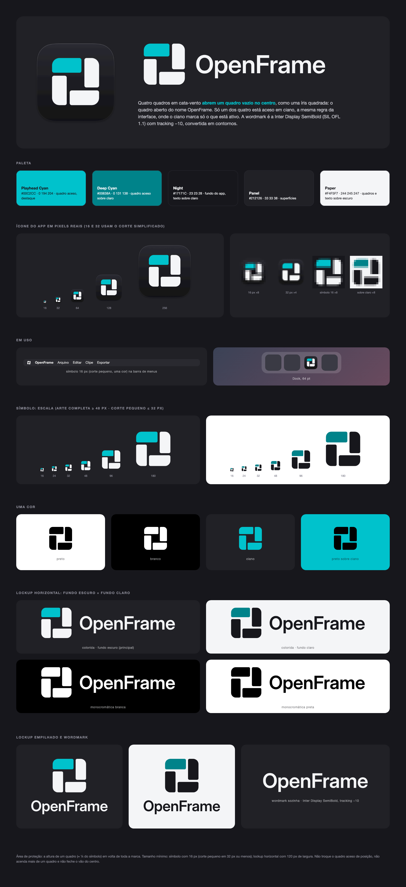

# OpenFrame — marca



## Conceito

**Quatro Quadros.** Quatro quadros 2:1 em cata-vento abrem um quadro vazio no centro, como uma íris quadrada: o
quadro aberto do nome OpenFrame. Só um dos quatro, o de cima, está aceso em ciano. É a mesma regra da interface do
app, onde o ciano marca só o que está ativo.

O desenho foi escolhido entre cinco opções (ver `exploration/`) por fugir da aparência do CapCut: blocos cheios em vez
de moldura em traço, nenhum lado aberto e nenhuma diagonal cruzada, além de cor como parte da ideia.

A grade é de 256. O lado externo mede 204, o vão central 60 e a folga entre as peças 12. Cada quadro tem raio 30 no
canto de fora e raio 8 nos outros cantos. O corte `small` (para 32 px ou menos) tem peças maiores e folga de 22.

## Wordmark

“OpenFrame” em **Inter Display SemiBold**, com tracking −10/1000 em, convertida em contornos (os SVGs não dependem da
fonte). No lockup horizontal, a caixa-alta tem 44 % da altura do símbolo e fica centrada nele. A distância entre o
símbolo e o texto é 0,62 da caixa-alta.

**Licença:** a Inter é de Rasmus Andersson e sai sob a [SIL Open Font License 1.1](https://openfontlicense.org), que
permite usá-la em logo, inclusive convertida em contornos. Os arquivos da fonte não ficam no repositório: só os
contornos, em `source/wordmark.json`. Não use a SF Pro na marca, porque a licença da Apple só permite usá-la em
mockups de interface. Dentro do app, a interface continua em SF Pro, que é a fonte do sistema.

## Paleta

| Nome | HEX | RGB | Uso |
|---|---|---|---|
| Playhead Cyan | `#00C2CC` | 0 194 204 | Quadro aceso / destaque (igual ao `Theme.accent`) |
| Deep Cyan | `#00838A` | 0 131 138 | Quadro aceso sobre fundo claro (contraste 4,5:1 com branco) |
| Night | `#17171C` | 23 23 28 | Fundo principal, quadros e texto sobre claro |
| Panel | `#212126` | 33 33 38 | Superfícies |
| Paper | `#F4F5F7` | 244 245 247 | Quadros e texto sobre escuro, fundo claro |

A versão principal é a **colorida sobre fundo escuro**: quadros Paper e o quadro de cima em Playhead Cyan.

## Arquivos

```
symbol/       openframe-symbol-{variante}.svg          símbolo (grade 256)
              openframe-symbol-small-{variante}.svg    corte para ≤ 32 px (folgas maiores)
wordmark/     openframe-wordmark-{variante}.svg
lockup/       openframe-lockup-horizontal-{variante}.svg
              openframe-lockup-stacked-{variante}.svg
png/          PNGs prontos do símbolo (512) e do lockup horizontal (1600 px de largura, transparentes)
appicon/      openframe-appicon.svg (+ -small.svg)     arte do ícone, 1024 com corpo squircle de 824
              png/openframe-appicon-{16,32,64,128,256,512,1024}.png
              AppIcon.iconset/  ·  AppIcon.icns
board/        openframe-board.html / .png              prancha: tamanhos, uma cor, invertida, lockups
exploration/  histórico: a marca anterior (Playhead Frame) e as cinco opções da v2
source/       build.py (SVGs) · board.py (prancha) · render.sh (PNGs, iconset, .icns e prancha)
              wordmark.py (Inter → wordmark.json)
```

As variantes são `color-on-dark`, `color-on-light`, `mono-black`, `mono-white` e `mono-cyan`.

## Uso

- **Área de proteção:** em volta de toda a marca, deixe pelo menos a altura de um quadro (≈ ¼ da altura do símbolo).
- **Tamanho mínimo:** símbolo com 16 px, usando o corte `small` em 32 px ou menos. Lockup horizontal com 120 px de
  largura.
- **Uma cor:** use `mono-black` em fundo claro e `mono-white` em fundo escuro ou sobre foto. Em fundo ciano, use
  `mono-black`.
- **Não faça:** acender mais de um quadro, trocar o quadro aceso de posição, girar ou espelhar o símbolo, fechar o vão
  do centro ou as folgas, aplicar sombra ou contorno, reescrever “OpenFrame” com outra fonte, ou usar o ciano claro
  sobre fundo claro (nesse caso, troque para Deep Cyan).

## Ícone do app (macOS)

O ícone segue a grade da Apple: canvas de 1024, corpo squircle (cantos contínuos) de 824 × 824 centrado, margem de
100 px e sombra suave dentro da margem. Os tamanhos 16 e 32 vêm do corte simplificado. O `scripts/make-app.sh` copia
`appicon/AppIcon.icns` para o bundle, e o `scripts/make-dmg.sh` usa o mesmo arquivo como ícone do volume.

No app, o símbolo é desenhado por `LogoMark` (`Sources/OpenFrame/Views/Theme.swift`), com a mesma geometria do
`build.py`, e passa para o corte pequeno quando tem 32 pt ou menos. A cabeça do playhead da timeline (`NeedleHead`)
faz parte da interface, não da marca.

## Regenerar

```sh
python3 assets/brand/source/build.py      # só os SVGs (lê source/wordmark.json; sem dependências)
zsh assets/brand/source/render.sh         # SVGs + PNGs + iconset + .icns + prancha (Chrome, sips, iconutil)
```

Para refazer os contornos da wordmark, baixe a Inter 4.1 em https://github.com/rsms/inter/releases e rode
`wordmark.py`. Ele precisa de `fontTools` e `uharfbuzz`; a ajuda fica no próprio script.

---
Antes de registrar a marca, faça uma busca profissional de anterioridade, porque esta prancha não garante que o
desenho esteja livre para registro.
